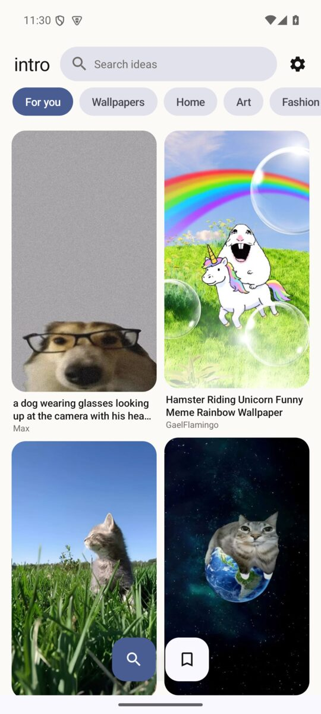
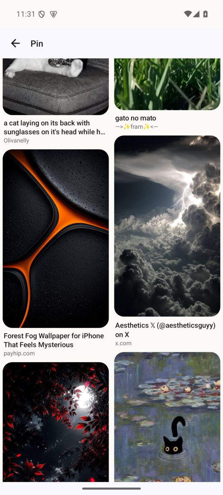

<div align="center">

# intro

**A Pinterest client alternative without the login.**

Browse, search, save, download, and sharpen pins — no account, no ads, no tracking.

[](https://developer.android.com)
[](https://m3.material.io)
[](#)
[](../../releases)

</div>

<table align="center">
  <tr>
    <td></td>
    <td></td>
  </tr>
  <tr>
    <td align="center"><sub>For You, tuned by your searches</sub></td>
    <td align="center"><sub>Scrollable detail with a masonry feed</sub></td>
  </tr>
</table>

## Features

- **No login, no ads.** Public Pinterest content, straight to your screen.
- **Material You.** Colors follow your wallpaper; separate floating rounded tabs.
- **For You that learns.** A tiny on-device algorithm remembers your last 30 searches and leads the feed with what you actually look for.
- **Vertical masonry.** Two-column variable-height pins, infinite scroll on both the home feed and the detail page.
- **Fill, never letterbox.** Pin images crop to fill their cards — no black bars.
- **RCAS sharpening.** One tap fetches the original and applies contrast-adaptive sharpening on-device.
- **Download, save, share.** Everything lands in `Pictures/intro`.
- **Auto search.** Results update as you type, without stealing your keyboard.
- **One-tap cleanup.** Clear the image cache and the local taste profile together.

## Tech

| | |
|---|---|
| Language | Java 17 |
| UI | Material 3, RecyclerView, StaggeredGridLayoutManager |
| Images | Glide (320 MB disk cache) |
| Network | OkHttp |
| Min SDK | 26 (Android 8.0) |
| Target SDK | 34 |

## Build

You need JDK 17 and Android SDK 35.

```bash
./gradlew :app:assembleRelease
```

The APK is written to `app/build/outputs/apk/release/app-release.apk`.

> The repo ships a demo signing key for convenience. Replace `app/pintro.jks` with your own before publishing a release.

## How it works

`intro` talks to Pinterest's public web endpoints directly, parses the pins locally, and renders them natively. Nothing is uploaded anywhere, and there is no account layer to leak.

The For You ranking lives entirely on-device in `TasteStore`: recent queries are normalized, deduplicated, and the most frequent one seeds the discover queue.

## Disclaimer

This is an unofficial client made for personal use. It is not affiliated with Pinterest. All images belong to their respective owners.

<div align="center"><sub>vibecoded by <a href="https://github.com/soynd">soynd</a></sub></div>
